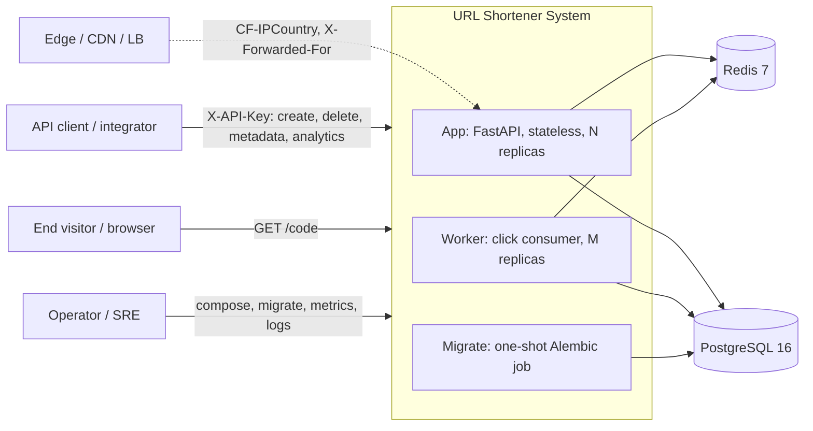
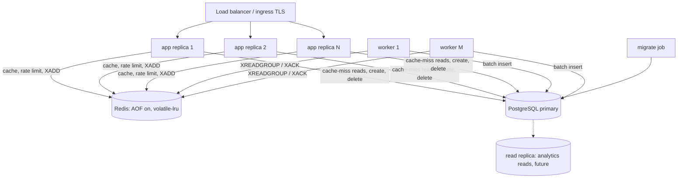
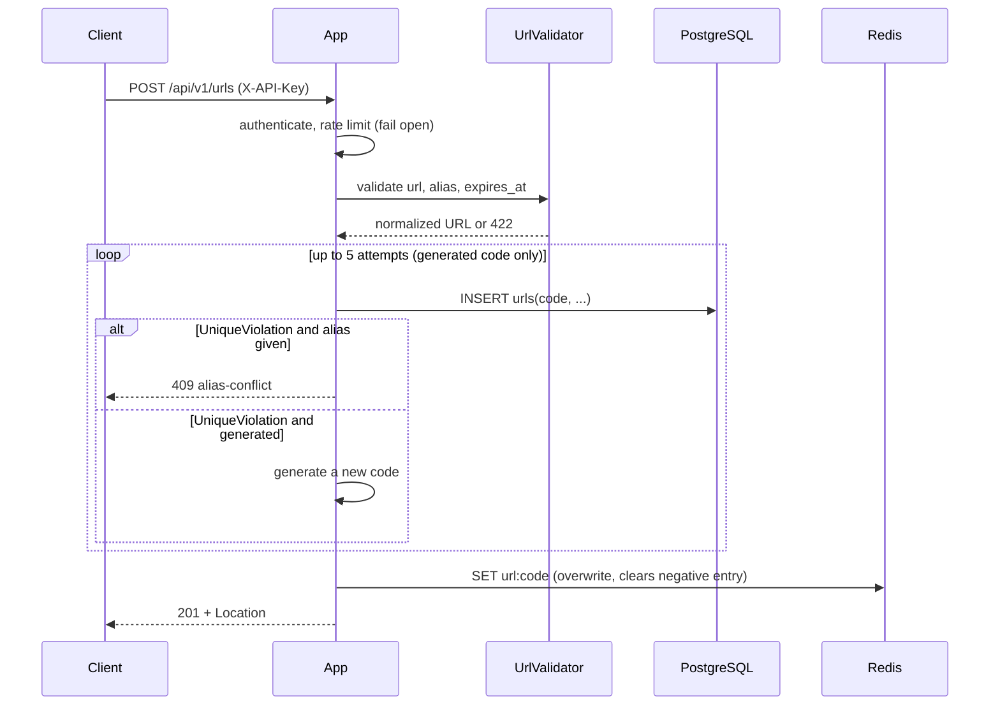
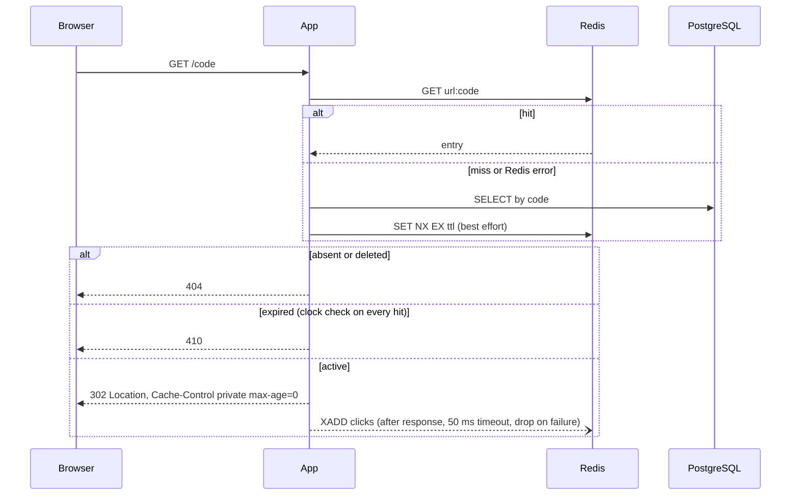

# Architecture Overview

Scope: Part B (URL shortener service) and how AI assistance is integrated into building it. Part A (the Engineering Copilot tool) is described in [COPILOT_PROTOTYPE.md](COPILOT_PROTOTYPE.md).
Status: Phase 2 design, **implemented in Phase 3** (`url-shortener/src/shortener/`). Behaviour statements are *design intent* unless marked **verified**; section 15 lists what Phase 3 actually verified, where the implementation differs from this design, and what is still unproven.

> **Provisional design targets (not verified capacity):** 100 M links, 5 k redirects/s peak, 50 creates/s. They size the design; only Phase 4 load tests will say what the implementation achieves.

## 1. Context



## 2. Containers & deployment



`docker compose up` (Phase 3) starts `postgres`, `redis`, `migrate` (runs once), `app`, `worker`. App and worker use the same image with different commands. Local compose uses one Redis for cache + stream; production should split them (ADR-004).

## 3. Code structure (layered, dependency-injected)

```
url-shortener/src/shortener/
  api/            FastAPI routers, request/response models, RFC 7807 handlers, middleware (request id, security headers)
  domain/         Pure rules: errors, URL validator + SSRF guard, alias rules, code generator, expiry logic. No I/O.
  services/       LinkService (create/resolve/get/delete), AnalyticsService (queries), RateLimiter
  ports.py        Protocols: LinkRepository, ClickRepository, LinkCache, ClickPublisher, Clock, CodeGenerator, DnsResolver
  infra/          Adapters: SQLAlchemy repositories, Redis cache, Redis Stream publisher, Redis rate-limit store
  worker/         Stream consumer loop (batching, ACK, reclaim, dead-letter)
  config.py       pydantic-settings, env only
  main.py         Composition root: wires adapters into services (the only place that knows concrete classes)
```

Rules: `api → services → ports ← infra`; `domain` imports nothing from the other layers. Services depend on protocols, so unit tests use in-memory fakes and integration tests use the real adapters. This is plain dependency inversion; no framework or container library.

## 4. Key flows

### 4.1 Create



### 4.2 Redirect



### 4.3 Analytics pipeline
See the diagram in [ADR-004](adr/ADR-004-analytics-redis-streams.md). Queries are read-only, owner-scoped, aggregated in SQL ([DB_SCHEMA.md](DB_SCHEMA.md) §4).

### 4.4 Delete
Check ownership → soft-delete row (`deleted_at = now()`) in PostgreSQL → write a `deleted` tombstone to Redis (ADR-005) → `204`. Redirect for that code is `404` from then on; the code can never be reused.

## 5. Security design (OWASP Top 10 mapping; verification happens in Phase 4)

| Risk | Control |
|---|---|
| A01 Broken access control | Owner-scoped API keys; non-owner gets `404` (ADR-006); redirect/health only are public. |
| A02 Cryptographic failures | Only SHA-256 hashes of keys in config; `secrets` for codes; TLS terminated at the edge; no secrets in repo, image, or logs. |
| A03 Injection | SQLAlchemy parameterised queries only; no string-built SQL; strict Pydantic models with `extra="forbid"`; alias regex. |
| A04 Insecure design | Threat-model driven validator (below); explicit failure modes (§7). |
| A05 Security misconfiguration | Non-root container, pinned base image, no debug mode, docs/openapi exposure configurable, security headers (`X-Content-Type-Options`, `Referrer-Policy`, `Cache-Control`). |
| A06 Vulnerable components | `pip-audit` + Dependabot-style pinned requirements in CI. |
| A07 Authentication failures | Constant-time hash comparison; per-key and per-IP rate limiting. |
| A08 Integrity failures | CI-built image; pinned action versions; idempotent event ingestion. |
| A09 Logging failures | Structured JSON logs with request id; keys, raw IPs, and full user-agents are not logged; log-redaction test. |
| A10 SSRF | The service **never fetches** target URLs. The risk is *being used as an open redirector to internal or malicious destinations*, handled by the URL guard below. |

**URL guard (domain layer):** length ≤ 2048; no control characters/whitespace; scheme ∈ {http, https}; no userinfo; host not `localhost` or ending `.local`/`.internal`; IP literals (decimal, hex, octal, short forms, bracketed IPv6, IPv4-mapped IPv6) normalised with the standard library and rejected when loopback, private, link-local, multicast, reserved, unspecified, or cloud metadata (`169.254.169.254`); host must not equal this service's own host (redirect loops); optional DNS resolution at create time rejecting hostnames that resolve to such addresses. **Residual risk (documented):** DNS rebinding after creation; mitigations are re-validation on a schedule (future) and an operator-maintained blocklist hook. A redirect is not a fetch, so rebinding affects the visitor's browser, not our network.

**Rate limiting:** Redis fixed-window counter (`INCR` + `EXPIRE`), keyed by API-key label for management routes and by client IP for redirects; defaults create 30/min, redirect 600/min per IP, both configurable. Fixed windows allow up to 2× burst at a window boundary (accepted for simplicity). **Fails open** if Redis is down. Client IP = the Nth entry from the right of `X-Forwarded-For`, where N = `TRUSTED_PROXY_HOPS` (so a client cannot spoof its address).

## 6. Scalability story (design intent)

| Concern | Approach |
|---|---|
| Stateless app tier | No in-process state affects correctness; any replica serves any request (AC-14). Scale out behind a load balancer. |
| Redirect hot path | Redis cache-aside (≈ 95 % hit rate assumed, **unverified**) ⇒ DB sees only misses. With the provisional peak of 5 k/s that would be ~250 reads/s on PostgreSQL. |
| Writes | Create path is one indexed insert. Code collisions are rare (ADR-002 math). |
| Analytics | Decoupled through Redis Streams; scale workers by adding consumers in the group; batch size 500 amortises round trips. |
| Database | Single primary + read replicas first; `clicks` partitioning/rollups, then sharding by `hash(code)` as later steps (ADR-003). |
| Known ceiling | By analysis (not measured), storing every click as a PostgreSQL row would not sustain 5 k clicks/s for 90 days. **Decision: v1 keeps raw rows**; partitioning and rollups are future improvements (§13). The 5,000 redirects/s target is not claimed without load-test evidence. |

## 7. Failure modes (what the user sees)

| Failure | Redirect | Create | Analytics |
|---|---|---|---|
| Redis down | Works via PostgreSQL; slower | Works; rate limit fails open; cache write skipped | Events dropped and counted (`/health/ready` returns `200` with `status: degraded`) |
| PostgreSQL down | Cache hits still work; misses return `503` | `503` | Stream buffers events (up to MAXLEN) while the worker retries |
| Worker down | Unaffected | Unaffected | Backlog grows in the stream; caught up on recovery; loss only if trimmed |
| App crash after response, before `XADD` | Unaffected | n/a | One event lost (accepted, ADR-004) |
| Stale cache after failed delete invalidation | Old link may redirect for ≤ 1 h | n/a | n/a (accepted; metric + log) |

## 8. Observability & configuration

- Logs: structlog JSON (`request_id`, route, status, latency_ms, owner label; never keys or IPs).
- Metrics (names reserved now, exported in Phase 3 via a small `/metrics` Prometheus endpoint): `clicks_dropped_total{reason}`, `cache_hits_total`, `cache_misses_total`, `cache_errors_total`, `rate_limit_rejections_total`, `click_stream_pending`, `click_ingest_lag_seconds`.
- Configuration is environment-only (`pydantic-settings`): `DATABASE_URL`, `REDIS_URL`, `API_KEYS` (label:sha256-hex list), `BASE_URL`, `ANALYTICS_SECRET` (derives the daily salt), `GEO_COUNTRY_HEADER` (default `CF-IPCountry`), `TRUSTED_PROXY_HOPS`, `CODE_LENGTH` (7), `CACHE_TTL_SECONDS` (3600), `NEGATIVE_CACHE_TTL_SECONDS` (30), `RATE_LIMIT_CREATE_PER_MIN`, `RATE_LIMIT_REDIRECT_PER_MIN`, `LOG_LEVEL`. No defaults for secrets; startup fails fast if they are missing.

## 9. Technology and verified versions

Resolved from PyPI by `pip` into a clean Python 3.11.4 virtual environment on 2026-11-20 (these are the versions Phase 3 will pin and test against). PostgreSQL 16.2 was exercised through an embedded build (`pgserver 0.1.4`), not the Docker image; Redis 7 and Docker-based runs are **not yet verified** because the Docker daemon is not running.

| Component | Version | Role |
|---|---|---|
| Python | 3.11.4 (project supports 3.11+) | Runtime |
| FastAPI / Starlette / Uvicorn | 0.165.0 / 1.10.0 / 0.54.0 | HTTP layer |
| Pydantic / pydantic-settings | 2.14.4 / 2.16.3 | Validation, config |
| SQLAlchemy (asyncio extra) / greenlet | 2.1.9 / 3.5.6 | ORM/Core; **`sqlalchemy[asyncio]` is required** (plain `sqlalchemy` fails at import of the async extension; found by running, not by reading docs) |
| asyncpg | 0.32.0 | PostgreSQL driver |
| Alembic | 1.20.1 | Migrations |
| redis-py | 8.1.0 | Cache, rate limit, streams |
| structlog | 26.1.0 | Structured logging |
| pytest / pytest-asyncio / pytest-cov / httpx | 9.2.0 / 1.5.0 / 7.1.0 / 0.28.1 | Tests |
| ruff / mypy / bandit / pip-audit | 0.17.6 / 2.4.1 / 1.9.4 / 2.10.1 | Lint, types, SAST, dependency scan |
| openapi-spec-validator | 0.9.0 | Contract lint (**used**: `openapi.yaml` validates as OpenAPI 3.1.0) |

API-surface caveat: these major versions are newer than much published example code. Every AI-suggested call is checked against the installed package (run it, or read its source), not against memory.

## 10. How AI assists each task (engineer owns every decision)

| Area | Copilot's role | Engineer's role (non-delegable) | Evidence |
|---|---|---|---|
| Requirements, ADRs | Draft options, trade-off tables, math | Choose; re-derive numbers; reject weak claims | `PHASE1_…md`, ADRs, usage log |
| OpenAPI, schema | Draft YAML/DDL | Decide status codes, constraints, indexes; execute against validator and a real PostgreSQL | Validation results in usage log |
| Domain logic (validator, generator) | Generate implementation and adversarial test tables | Threat-model bypasses; verify stdlib semantics; mutation-check tests | Phase 3 logs |
| Adapters (SQL, Redis) | Scaffold repositories/cache/stream code | Review queries, races, TTLs, failure paths; run against real services | Phase 3 logs |
| Tests | Generate skeletons, parametrised tables | Delete tautological tests; break the code on purpose and confirm tests fail | Phase 4 report |
| CI, Docker | Draft files | Pin versions, least privilege, run them | Phase 3/4 |
| Docs | Draft prose | Verify every command and claim | Phase 6 |

Prompting pattern for every AI task: *role + task + inputs + constraints + output format + "what to double check"*; the exact prompt, the raw suggestion summary, and the accept/modify/reject decision with reasons are appended to [AI_USAGE_LOG.md](AI_USAGE_LOG.md).

## 11. Key trade-offs

| Choice | Gain | Cost accepted |
|---|---|---|
| 302 over 301 | Accurate analytics; instant revocation | More load on our stack; no SEO transfer |
| Random Base62 + DB uniqueness | No coordination, unguessable | A retry loop, vanishingly rare collisions |
| PostgreSQL only (no KV/columnar) | One datastore, transactional uniqueness | Click storage ceiling at very high volume |
| Redis Streams for clicks | Durable-ish, decoupled, scalable | New worker process; Redis is stateful; app→Redis emit is best effort |
| Tombstone cache invalidation | No stale-writeback race | Slightly more complex cache code |
| API keys in config | Minimal, secure enough for v1 | Manual issuance, no self-service |
| Single Redis in compose | One-command simplicity | Not production-grade isolation (documented) |

## 12. Approved API semantics and privacy rules (Phase 2 sign-off)

- Non-owner access to a link returns `404` (never `403`), so existence is not disclosed.
- An expired link returns `200` with `status: expired` from the metadata endpoint for its owner; the public redirect returns `410`.
- `/health/ready`: `200 ok`; `200 degraded` when **only** Redis is down (core service still works); `503 unavailable` when PostgreSQL is down.
- Referrers are stored as **origin only** (`scheme://host[:port]`); paths and query strings are never stored (ADR-004, DB CHECK constraint).
- Load testing uses **Locust** (Phase 4). Locust 2.47.0 resolves under Python 3.11 (dry run); it is not installed yet.

## 13. Future improvements (documented, deliberately not built in v1)

Monthly partitioning of `clicks`; daily rollup table; columnar store for analytics; read replicas; separate Redis instances for cache and stream; in-process L1 cache with pub/sub invalidation; Kafka behind the `ClickPublisher` port; retention purge job; DNS re-validation of stored targets.

## 14. Architecture Decision Records

[ADR-001 302](adr/ADR-001-redirect-302.md) · [ADR-002 Code generation](adr/ADR-002-code-generation.md) · [ADR-003 PostgreSQL](adr/ADR-003-postgresql-system-of-record.md) · [ADR-004 Redis Streams analytics](adr/ADR-004-analytics-redis-streams.md) · [ADR-005 Cache strategy](adr/ADR-005-cache-strategy.md) · [ADR-006 API-key auth](adr/ADR-006-api-key-auth.md)

Contracts: [openapi.yaml](../url-shortener/openapi.yaml) · [DB_SCHEMA.md](DB_SCHEMA.md)

## 15. Phase 3 implementation notes (what was built, verified, and changed)

**Verified by running (2026-11-20, Windows host, Docker Desktop 29.9.3, PostgreSQL 16 and Redis 7 in containers):**

| Claim | Evidence |
|---|---|
| Acceptance criteria AC-1..AC-12 and AC-14 hold against real PostgreSQL and Redis | `tests/integration/test_api_e2e.py` (incl. 50 concurrent creates of one alias: exactly one `201`, 49 `409`) |
| AC-13: a clean checkout starts with one command | `docker compose down -v` then `docker compose up -d --build --wait`: exit 0 in 15 s, migrations applied, `/health` `200`, app runs as uid 10001 |
| Running service matches `openapi.yaml` | `tests/contract/`: responses validated against the spec's own JSON Schemas; operation set and operationIds identical |
| Click pipeline: at-least-once delivery, idempotent storage, poison handling | `tests/integration/test_worker.py` (redelivery after crash, commit-then-crash, dead-lettering, reclaim, two workers, graceful stop) |
| Redirect works with Redis down; analytics emit never delays the response | integration test AC-11, ASGI-level test that the response completes before the (slow) publish, live check with `docker compose stop redis` |
| Migrations round-trip and models match them | `alembic upgrade → downgrade base → upgrade`, `alembic check` (no drift), single head |
| Static checks | `ruff`, `mypy --strict` (36 files), `bandit` (0 findings), `pip-audit` (no known vulnerabilities), Trivy on the image (clean after Phase 4 fixes) |
| Test strength | 426 tests (Phase 4 count; 384 at the Phase 3 commit), 96 % statement/branch coverage overall, 99 % on `link_service.py`; manual mutation run in `.agent/mutation_check.py` (20 of 22 mutants killed; see AI_USAGE_LOG entry 026; not repeated after the Phase 4 fixes) |

**Differences from the Phase 2 design (all deliberate, each found by running the system):**

- **Circuit breaker for Redis** (`infra/circuit_breaker.py`, shared by cache, limiter, and publisher). Design said "fall back to PostgreSQL on Redis error" but a live test showed every redirect then paid several failed connect attempts (839 ms with the Redis container stopped). After 3 consecutive failures Redis is skipped for 5 s; measured: first request 549 ms, then 5-30 ms. Dropped events while open are counted as `clicks_dropped_total{reason="circuit_open"}`.
- **Counter update locks rows first** (`FOR NO KEY UPDATE ... ORDER BY id`) so concurrent workers take locks in the same order; the retry on `40P01`/`40001` remains as a safety net. *Limit:* I could not reproduce a deadlock without it (see AI_USAGE_LOG entry 026), so its necessity is unproven.
- **Extra configuration** beyond section 8: `RATE_LIMIT_API_PER_MIN` (300; limit for non-create management calls, also throttles failed key attempts per client address), `DNS_CHECK_ENABLED`, `DNS_TIMEOUT_SECONDS`, `DOCS_ENABLED` (default off), `METRICS_ENABLED`, `CLICK_EMIT_TIMEOUT_MS` (50), `CLICK_STREAM_MAXLEN`, `REDIS_SOCKET_TIMEOUT_SECONDS`, `DB_POOL_SIZE`, `DB_MAX_OVERFLOW`.
- **DNS check is advisory:** hostnames that fail to resolve are accepted (only a resolution to a non-public address is rejected), so an offline machine can still create links.
- **`/metrics`** is a small hand-written Prometheus text endpoint (counters plus `click_stream_length` / `click_stream_pending` gauges), unauthenticated, and (since the Phase 4 review) **off by default** (`METRICS_ENABLED=false`); compose turns it on for loopback-only development. Restrict it at the ingress anywhere shared.
- **Phase 4 hardening (see [VALIDATION.md](VALIDATION.md))**: `TRUST_GEO_HEADER` (default false: the country header is client-controlled unless the edge rewrites it); the application refuses to start with the published demo keys or `*_dev_only` passwords unless `BASE_URL` is localhost (`ALLOW_DEV_CREDENTIALS` is the break-glass switch used by tests); validation errors no longer echo submitted settings; DB exception text hides bound parameters; compose containers run read-only with all capabilities dropped; the image was patched and re-scanned (Trivy clean).

**Known limits and unproven claims (do not read these as capacity or security guarantees):**

- The GitHub Actions workflow (`.github/workflows/ci.yml`) has **not been run**: there is no remote. Its steps were exercised locally one by one; its YAML parses; action versions are pinned to commit SHAs.
- Nothing here has been **successfully** load tested: a first measurement series exists but was incomplete and not reproducible from stored artifacts, so the 5,000 redirects/s target remains an unverified design target. See [LOAD_TEST.md](LOAD_TEST.md) (one uvicorn process saturated near 370-390 req/s on the shared laptop; scaling behaviour is unexplained).
- With Redis *blackholed* (packets dropped rather than refused) the first calls wait up to `REDIS_SOCKET_TIMEOUT_SECONDS` (0.25 s) each before the breaker opens; not measured.
- Rate limiting identifies clients by the address `TRUSTED_PROXY_HOPS` yields. Behind an unconfigured proxy every visitor shares one address (and one redirect limit).
- A PostgreSQL outage longer than about `max_deliveries` reclaim cycles (5 x 60 s) moves pending click events to `clicks:dead` (kept, not lost, but not counted until re-driven by hand; no re-drive tool exists yet).
- The static analysers and scanners cover the code and pinned dependencies. A Trivy image scan was run in Phase 4 (HIGH findings fixed, re-scan clean); there is still no DAST, fuzzing, or human penetration test.
