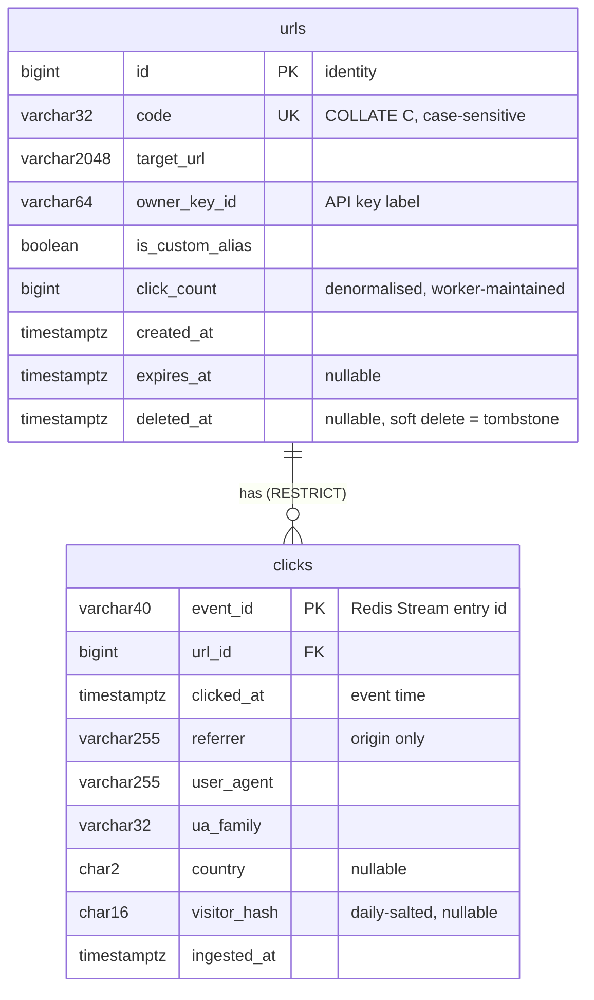

# Database Schema & Migration Strategy

PostgreSQL 16. Source of truth for the schema is the Alembic migration
[`url-shortener/migrations/versions/0001_initial_schema.py`](../url-shortener/migrations/versions/0001_initial_schema.py). This page explains the design; if they ever disagree, the migration wins and this page is a bug.

## 1. ER diagram



## 2. Design decisions

| Decision | Why |
|---|---|
| `urls.id` identity PK + separate `code` unique | Compact FK target for `clicks` (8 bytes instead of up to 32); `code` stays a user-facing value. |
| `UNIQUE(code)` with `COLLATE "C"` | Race-free alias/code uniqueness enforced by the DB (ADR-002); byte-wise comparison keeps `Promo` ≠ `promo` on any database default collation. Verified. |
| Soft delete only (`deleted_at`) | The retained row + unique constraint is the permanent alias tombstone (Phase 1 decision 4, ADR-003). `ON DELETE RESTRICT` blocks hard deletes of rows with clicks. |
| CHECK constraints (`code` format, `http(s)` scheme, expiry after creation, non-negative counter, country format, referrer is an origin) | Defence in depth: bad data from a bug or a manual SQL session is rejected even if application validation is bypassed. Not a replacement for app validation (SSRF checks cannot be expressed in SQL). |
| `clicks.event_id` = PK | Redis Stream entry id gives idempotent redelivery (`ON CONFLICT DO NOTHING`) without a surrogate key plus a second unique index. IDs are millisecond-timestamp based, so a recreated stream does not reuse old ids. |
| `clicked_at` (event time) vs `ingested_at` | Analytics are bucketed by when the click happened; `ingested_at - clicked_at` measures pipeline lag. |
| `referrer` stored as origin only (enforced by CHECK `ck_clicks_referrer_origin`); no raw IP | Approved Phase 2 decision. Privacy (A8): paths and queries in referrers can carry tokens/PII. `visitor_hash` is `HMAC(daily_salt, ip‖ua)` truncated to 16 hex chars, so it cannot be reversed to an IP and cannot track a visitor across days. |
| `urls.click_count` denormalised | Metadata reads must not `COUNT(*)` the clicks table. Maintained by the worker in the same transaction as the insert (§4). |

## 3. Indexes (every index must justify its write cost)

| Index | Serves | Notes |
|---|---|---|
| `uq_urls_code` (unique btree on `code`) | Redirect cache-miss lookup, metadata, delete, uniqueness | The single hot read path. `EXPLAIN` confirmed an index scan. |
| `pk_urls` (`id`) | FK checks from `clicks`, worker counter updates | |
| `pk_clicks` (`event_id`) | Idempotent insert | |
| `ix_clicks_url_id_clicked_at` (`url_id, clicked_at DESC, event_id DESC`) | Window aggregates and keyset pagination for one link | Row-comparison pagination `(clicked_at, event_id) < (…)` verified. |

Deliberately **not** created (YAGNI until a feature needs them): index on `owner_key_id` (no list endpoint), partial index on `expires_at` (no purge job in v1), index on `referrer`/`country` (top-N runs over the already-narrow per-link range).

## 4. Verified access patterns

These statements were executed against a real PostgreSQL 16.2 instance (embedded server, results recorded in the AI usage log) and return the expected rows.

Worker batch (one transaction; counters only for rows actually inserted, so redelivery cannot double count):

```sql
WITH ins AS (
  INSERT INTO clicks (event_id, url_id, clicked_at, referrer, user_agent, ua_family, country, visitor_hash)
  SELECT * FROM unnest(:event_id::varchar[], :url_id::bigint[], :clicked_at::timestamptz[],
                       :referrer::varchar[], :user_agent::varchar[], :ua_family::varchar[],
                       :country::char(2)[], :visitor_hash::char(16)[])
  ON CONFLICT (event_id) DO NOTHING
  RETURNING url_id
), agg AS (SELECT url_id, count(*) AS n FROM ins GROUP BY url_id)
UPDATE urls u SET click_count = u.click_count + agg.n FROM agg WHERE u.id = agg.url_id;
```

Caveat: concurrent workers touching overlapping links can deadlock on the `UPDATE`. The worker retries the whole batch on `40P01`/`40001`; this is safe because the insert is idempotent. (Covered by an integration test in Phase 3.)

Analytics (window `[from, to)`):

```sql
-- totals and approximate unique visitors
SELECT count(*), count(DISTINCT visitor_hash) FROM clicks
 WHERE url_id = :id AND clicked_at >= :from AND clicked_at < :to;
-- time series (granularity hour|day)
SELECT date_trunc(:granularity, clicked_at, 'UTC') AS bucket, count(*) FROM clicks
 WHERE url_id = :id AND clicked_at >= :from AND clicked_at < :to GROUP BY 1 ORDER BY 1;
-- top-N (referrer / ua_family / country analogous)
SELECT referrer, count(*) FROM clicks WHERE url_id = :id AND clicked_at >= :from AND clicked_at < :to
 GROUP BY referrer ORDER BY count(*) DESC, referrer LIMIT 10;
-- recent clicks, keyset pagination (cursor = last clicked_at, event_id)
SELECT * FROM clicks WHERE url_id = :id AND clicked_at >= :from AND clicked_at < :to
   AND (clicked_at, event_id) < (:cursor_ts, :cursor_id)
 ORDER BY clicked_at DESC, event_id DESC LIMIT :limit;
```
`approx_unique_visitors` over-counts people who return on different days (daily salt). That limitation is part of the API description.

## 5. Constraint behaviour verified on PostgreSQL 16.2

| Check | Result |
|---|---|
| `Promo` and `promo` are both accepted (case-sensitive) | pass |
| Duplicate code → `UniqueViolation` | pass |
| Re-insert of a soft-deleted code → `UniqueViolation` (tombstone) | pass |
| Bad charset, length < 3, `javascript:` target, expiry before creation, bad country → `CheckViolation` | pass |
| Referrer accepts `https://host`, `http://host:8080`, NULL; rejects path, query, fragment, userinfo, `ftp://`, whitespace, scheme-less, empty host (9 negative cases) | pass |
| Click with unknown `url_id` → `ForeignKeyViolation`; hard delete of a link with clicks → rejected | pass |
| Redelivered click ignored; counter incremented once | pass |
| `alembic upgrade head` → `downgrade base` → `upgrade head` | pass |
| `alembic upgrade head --sql` (offline SQL for DBAs) | pass |

Limits of this validation: the query plans were checked on tiny tables with `enable_seqscan = off`, which proves the indexes are *usable* for these predicates, not their performance at scale. Real timings come from the Phase 4 load test.

## 6. Migration strategy

| Topic | Policy |
|---|---|
| Tool | Alembic 1.20 with SQLAlchemy 2.1 async engine (`asyncpg`). `DATABASE_URL` is read from the environment only. |
| Who runs migrations | A **one-shot `migrate` job** (`alembic upgrade head`), not the app on startup. In compose: a `migrate` service that `app` and `worker` wait on (`depends_on: condition: service_completed_successfully`). In Kubernetes: a pre-deploy Job. With N replicas starting at once, a single runner avoids races. |
| Direction | Forward-only in production. `downgrade()` exists for local dev and CI round-trip tests, not as an emergency tool for data-bearing migrations. |
| Zero-downtime rule (expand → migrate → contract) | Release N adds nullable columns/new tables (backward compatible with N-1 code). Release N+1 backfills and switches reads. Release N+2 drops the old column. Never rename or drop in the same release that stops using it. |
| Locks | Index creation on large tables uses `CREATE INDEX CONCURRENTLY` (needs `autocommit_block()` in the migration). New `NOT NULL` columns on big tables are added nullable, backfilled in batches, then constrained with `NOT VALID` + `VALIDATE CONSTRAINT`. Migrations set `lock_timeout` to fail fast instead of queueing behind traffic. |
| Review checklist for every migration | Backward compatible with previous app version? Lock level and duration? Index justified and not duplicating another? Reversible in dev? Tested on a populated table? |
| CI gates (Phase 3/4) | (1) `upgrade head` on an empty database; (2) `upgrade → downgrade base → upgrade`; (3) `alembic check` once ORM metadata is wired into `env.py`, to catch model/migration drift; (4) one linear head only (fail on branch heads). |
| Seed data | None in migrations. Reserved aliases live in code (domain validation), not in the database. |
| Retention (documented, not built) | A purge job deletes `clicks` older than `CLICK_RETENTION_DAYS` (default 90) in batches; at larger scale replace with monthly partitions and `DROP PARTITION` (ADR-003 upgrade path). |
