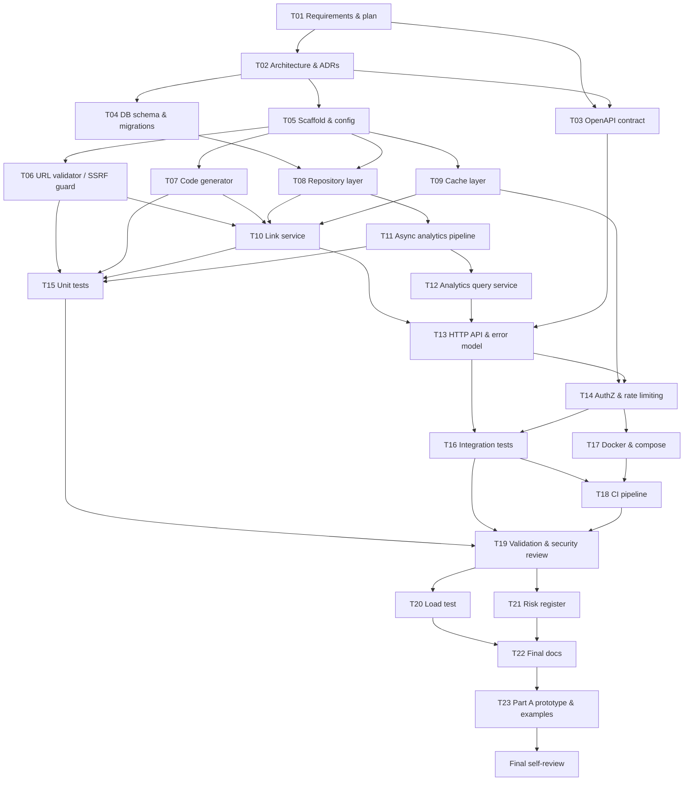

# Phase 1 — Requirement Understanding & Task Decomposition (URL Shortener)

> Status: **APPROVED by the engineer (2026-11-20) with the decisions recorded in §6.** Content was AI-drafted; the engineer accepted/changed it.
> Rows changed by the approval are marked **[Rev. after approval]**.

---

## Stage 1 — Requirement Understanding

### 1.1 Interpretation

| Aspect | Interpretation |
|---|---|
| Source requirement | "Build a scalable URL shortener service with APIs, persistence, analytics." |
| Business goal | Turn long URLs into short, shareable links, redirect fast and reliably, and give link owners click insight. |
| Users | **Link creator** (API client / integrator), **End visitor** (follows short link, latency-sensitive, anonymous), **Operator/SRE** (deploys, scales, monitors), **Abuse/Security reviewer** (needs to limit misuse). |
| Success criteria | Redirects are fast (cache hit p95 < 50 ms at the service), creation is collision-safe, analytics never slow or break a redirect, service is stateless and horizontally scalable, abuse vectors (SSRF, open-redirect, scheme injection) are blocked, one-command startup. |

### 1.2 Ambiguities & missing information (and how we proceed)

| # | Ambiguity | Why it matters | **Labeled assumption (A-n)** used to continue |
|---|---|---|---|
| Q1 | Who may create/delete/view analytics? Spec lists DELETE but no authN. | An unauthenticated DELETE lets anyone destroy any link (OWASP A01). | **A1**: Static API keys from env (`API_KEYS`, stored/compared as SHA-256 hashes) guard `POST/DELETE/metadata/analytics`. Redirect + `/health` are public. Each link records its `owner_key_id`; only the owner key can delete or read analytics. No user accounts/OAuth in v1. |
| Q2 | Expected scale? "Scalable" is unquantified. | Drives code length, cache, DB sizing, load test targets. | **A2** **[Rev. after approval]**: 100 M links total, 100 : 1 read:write, peak 5 k redirects/s and 50 creates/s cluster-wide. These are **provisional design targets, not verified capacity claims**; the Phase 4 load test will report only what is measured on the test machine. |
| Q3 | 301 vs 302? | 301 is cached by browsers → analytics undercount, expiry/delete not honored. | **A3**: **302** default (ADR-001). Revisit if the business prioritises SEO/CDN offload over accuracy. |
| Q4 | Custom alias rules? | Collisions, impersonation of routes (`api`, `health`), homoglyph/offensive aliases. | **A4**: `^[A-Za-z0-9_-]{3,32}$`, case-sensitive, reserved-word deny-list (`api`, `health`, `docs`, `openapi.json`, …). Duplicate alias → `409 Conflict` (this is exactly the brownfield bug scenario in `examples/`). |
| Q5 | Expiry semantics? | Format, max, behaviour after expiry. | **A5**: Optional `expires_at` (ISO-8601 UTC) must be in the future and ≤ 5 years out. After expiry redirect returns **410 Gone**; expired rows retained for analytics until a purge job (out of scope; documented). Default: never expires. |
| Q6 | Deleting: hard vs soft; can alias be reused? | Safety against takeover of a deleted alias by a phisher. | **A6**: Soft delete (`deleted_at`), redirect returns **404**; alias is **not reusable** (tombstone) in v1. Analytics retained per A8. |
| Q7 | Same long URL submitted twice? | Dedup saves space but leaks cross-owner info, breaks per-link analytics. | **A7**: **No dedup** — every create yields a new code. |
| Q8 | Analytics fields & retention; "geo if available". | Privacy (GDPR) and cost. | **A8** **[Rev. at Phase 2 approval]**: Per click: `clicked_at`, `referrer` (**origin only: scheme + host[:port]; paths, query strings, fragments, and userinfo are never stored**; unparseable or non-http(s) referrers are stored as `NULL`), `user_agent` (truncated 255, plus coarse family), `country` from a trusted edge header (`CF-IPCountry`, configurable) else `NULL`. **Raw IP is never stored**; only a daily-salted hash for approximate unique counts. Raw events retained 90 days (purge job documented, not built). No in-process GeoIP DB in v1. |
| Q9 | Analytics durability vs latency. | Async writes can lose events on crash. | **A9** **[Rev. after approval]**: Click events go to a **Redis Stream** (consumer group); a separate worker batch-inserts into PostgreSQL, ACKs after commit, and inserts idempotently (event id = primary key) → at-least-once delivery, effectively-once storage. Residual loss windows (Redis outage at emit time, crash before emit, Redis crash within AOF fsync window, stream trimmed before consumption) are documented in ADR-004; failed emits are dropped and counted, never block a redirect. Replaces the in-process queue. |
| Q10 | SSRF — does the service fetch target URLs? | Defines the real guard needed. | **A10**: Service **never fetches** target URLs. The "SSRF/malicious URL guard" therefore means: scheme allow-list (`http`, `https`), reject userinfo (`user:pass@`), reject `localhost`, private/loopback/link-local/metadata IPs (incl. decimal/hex/IPv6-mapped forms), optional DNS resolution check at create time, max length 2048, blocklist hook. DNS-rebinding after creation is a documented residual risk. |
| Q11 | Rate-limit policy? | Abuse, cost. | **A11**: Redis fixed/sliding-window per client (API key or IP): create 30/min, redirect 600/min per IP, configurable. **Fail-open** if Redis is down (availability over strictness), logged + metric. |
| Q12 | Multi-region, custom domains, QR codes, bulk create, link editing (PATCH), UI. | Scope creep. | **A12**: All **out of scope**. |
| Q13 | Tech stack not specified. | Needed to plan tasks. | **A13** **[Rev. after approval]**: Python **3.11+** (target/CI 3.11; local interpreter is 3.11.4), FastAPI, SQLAlchemy 2.x (async) + asyncpg, Alembic, PostgreSQL 16, Redis 7, pydantic-settings, structlog, pytest/pytest-asyncio/httpx, ruff, mypy, Bandit, pip-audit, **Locust** (load testing; Python-only, no extra runtime. Decided at Phase 2 approval; k6 dropped). Versions resolved from PyPI on 2026-11-20 are listed in `docs/ARCHITECTURE.md` §9. |

### 1.3 Implicit non-functional requirements

| NFR | Target / approach (design goal, to be measured) |
|---|---|
| Scale | A2 numbers; stateless app tier, scale-out behind LB; Postgres primary + read replicas; Redis shared cache. |
| Latency | Redirect p95 < 50 ms (cache hit, service-side), < 150 ms (cache miss). Create p95 < 200 ms. |
| Availability | 99.9 %. Redirect path survives Redis outage (falls back to DB) and analytics outage (never blocks). |
| Security | OWASP Top 10 review; secrets via env only; input validation; RFC 7807 errors without internals; security headers; no PII in logs. |
| Privacy/retention | See A8. |
| Observability | Structured JSON logs w/ request id, `/health` (liveness) + `/health/ready` (DB/Redis), basic counters (dropped analytics, cache hit ratio). |
| Maintainability | Layered (api → service → repository), DI, strong typing (mypy strict), ≥ 85 % coverage on core logic. |
| Operability | Dockerfile (non-root, multi-stage), docker-compose app+db+redis, migrations via one-shot job. |

### 1.4 Edge cases to cover (feeds test plan)

- Alias: exists, reserved, too short/long, bad charset, differs only by case, concurrent create of same alias (race → unique-constraint, not check-then-insert).
- Generated code collision (simulate with fake generator) → bounded retry, then 503 problem.
- URL: no scheme, `javascript:`/`data:`/`file:`/`ftp:`, userinfo, IP literals (`127.1`, `0x7f.1`, `[::1]`, `::ffff:10.0.0.1`), `169.254.169.254`, internal hostnames, IDN/punycode, > 2048 chars, whitespace/control chars, URL pointing at the shortener itself (redirect loop).
- Expiry: past, now, far future, naive datetime, exactly-at-boundary on redirect.
- Redirect: unknown, expired (410), deleted (404), cache staleness after delete (invalidate), negative caching of 404s with short TTL, expiry shorter than cache TTL.
- Analytics: queue full, DB down, huge/malicious UA or referrer, missing headers, HEAD requests (decision: count GET only).
- Rate limit: burst, Redis down, `X-Forwarded-For` spoofing (trust only configured proxy hops).

### 1.5 Engineering problem statement

**Scope (in).** A stateless HTTP service that (1) creates short links for validated http(s) URLs with optional custom alias and expiry, (2) redirects with low latency using a Redis read-through cache over PostgreSQL, (3) exposes link metadata, deletion, and per-link click analytics, (4) records clicks asynchronously without affecting redirect latency, (5) protects against abuse (validation, SSRF guard, rate limit, API-key authZ), (6) ships with migrations, OpenAPI 3.x contract, Docker/compose, CI, tests, and a load test.

**Out of scope.** User accounts/OAuth, link editing (PATCH), custom domains, QR codes, bulk APIs, UI, multi-region, GeoIP database, purge/retention job (documented only), fetching/previewing target pages, link-reputation services (hook only).

**Functional requirements**

| ID | Requirement |
|---|---|
| FR-1 | `POST /api/v1/urls` creates a link: body `{url, alias?, expires_at?}` → `201` + metadata + `Location` of the resource. |
| FR-2 | `GET /{code}` → `302` to target; `404` unknown/deleted; `410` expired. Sets `Cache-Control: private, max-age=0` (A3) and `Referrer-Policy`. |
| FR-3 | `GET /api/v1/urls/{code}` → metadata (code, short_url, target, created_at, expires_at, status, total clicks). |
| FR-4 | `DELETE /api/v1/urls/{code}` → `204`; owner only; invalidates cache. |
| FR-5 | `GET /api/v1/urls/{code}/analytics?from&to&granularity=` → total clicks, clicks over time, top referrers, top user-agent families, countries; plus recent raw clicks (paged). |
| FR-6 | `GET /health` → liveness; `GET /health/ready` → DB + Redis status. |
| FR-7 | All errors use RFC 7807 `application/problem+json`. |
| FR-8 | Rate limiting returns `429` with `Retry-After`. |

**Non-functional requirements:** see §1.3.

### 1.6 Acceptance criteria (Given/When/Then)

| ID | Criterion |
|---|---|
| AC-1 | **Given** a valid API key **When** I POST `{"url":"https://example.com/a"}` **Then** I get `201` with a 7-char Base62 `code` and `short_url`. |
| AC-2 | **Given** alias `promo` is free **When** I create with alias `promo` **Then** `201` and `GET /promo` redirects. |
| AC-3 | **Given** alias `promo` exists **When** I create another with `promo` **Then** `409` problem+json; the original link is unchanged (also under 50 concurrent attempts, exactly one succeeds). |
| AC-4 | **Given** a URL with scheme `javascript:`, userinfo, or resolving to a private IP **When** I create **Then** `422` problem+json naming the field, nothing persisted. |
| AC-5 | **Given** `expires_at` in the past **When** I create **Then** `422`. |
| AC-6 | **Given** a link past `expires_at` **When** a visitor requests it **Then** `410`, even if the cache entry is still warm. |
| AC-7 | **Given** a cached link **When** the owner deletes it **Then** the next `GET /{code}` is `404` (cache invalidated). |
| AC-8 | **Given** a missing/invalid API key **When** calling DELETE/analytics **Then** `401`; **given** a non-owner key **Then** `404` (no existence leak). |
| AC-9 | **Given** 3 visits with referrers **When** I fetch analytics **Then** totals, referrer breakdown, and timestamps match, eventually (≤ flush interval, default 1 s). |
| AC-10 | **Given** the analytics DB write fails **When** a visitor follows a link **Then** the redirect still succeeds within the latency budget. |
| AC-11 | **Given** Redis is down **When** a visitor follows a link **Then** the redirect still succeeds via DB, and `/health/ready` reports degraded. |
| AC-12 | **Given** a client exceeding the limit **When** it sends another request **Then** `429` + `Retry-After`. |
| AC-13 | **Given** a clean checkout **When** I run `docker compose up` **Then** app, Postgres, Redis start, migrations apply, and `/health` returns 200. |
| AC-14 | **Given** two app replicas **When** requests alternate between them **Then** behaviour is identical (no per-process state affecting correctness). |

---

## Stage 2 — Task Decomposition (Engineer-Led)

### 2.1 Task table

**Copilot** = what AI drafts; **Engineer** = what the human designs/decides/verifies (non-delegable). Phase maps to your phase gates.

| ID | Title | Description / Inputs → Outputs | Definition of Done | AI assist (Copilot) | Engineer responsibility | Phase |
|---|---|---|---|---|---|---|
| T01 | Requirements & plan | Raw requirement → this document | Approved by engineer | Draft analysis, assumptions, DAG | Accept/reject assumptions, scope | 1 |
| T02 | Architecture & ADRs | Approved plan → `ARCHITECTURE.md`, ADR-001..005 | Each ADR has context/options/decision/consequences | Draft options + trade-off tables | Choose; challenge claims (301 vs 302, collision math) | 2 |
| T03 | API contract | FR list → `openapi.yaml` (3.1) | Validates with a spec validator; all errors use problem+json | Draft schemas/examples | Review status codes, security scheme, field constraints | 2 |
| T04 | DB schema & migrations | Entities → Alembic migrations (`urls`, `clicks`) | Up/down tested on Postgres; indexes justified | Draft DDL | Design keys, unique constraints, indexes, partitioning stance; review locks/perf | 2 |
| T05 | Project scaffold & config | → pyproject, layout, settings, structlog, DI wiring, Makefile | `ruff`, `mypy --strict` green; no secrets in repo | Scaffold boilerplate | Decide structure, config surface, dependency versions | 3 |
| T06 | URL validator & SSRF guard | Raw URL → normalized safe URL or error | Table-driven tests for every edge in §1.4 pass | Generate parser/IP checks + test cases | Threat-model bypasses (encodings, IPv6-mapped, DNS); verify vs stdlib `ipaddress` semantics | 3 |
| T07 | Short-code generator | → `CodeGenerator` protocol; random Base62 (7 chars, `secrets`) + alias validation + reserved list | Retry logic tested with fake generator; birthday-bound documented | Draft impl | Justify strategy (ADR-002); verify no modulo bias, `secrets` not `random` | 3 |
| T08 | Repository layer | Schema → async SQLAlchemy repos (`UrlRepository`, `ClickRepository`) | Parameterized queries only; unique-violation mapped to domain error; no N+1 | Scaffold CRUD | Review queries/indexes via `EXPLAIN`; concurrency semantics | 3 |
| T09 | Cache layer | → Redis read-through, negative cache, invalidate-on-delete, TTL ≤ time-to-expiry | Tests: hit/miss/invalidate/outage fallback | Draft adapter | Decide TTLs & invalidation (ADR-005); failure modes | 3 |
| T10 | Link service (domain) | validator+generator+repo+cache → `create/resolve/get/delete` | Unit tests with fakes; ≥ 90 % branch on this module | Draft orchestration | Own business rules (expiry, ownership, tombstones) | 3 |
| T11 | Async analytics pipeline **[Rev. after approval]** | Click events → Redis Stream (producer in app) → consumer-group worker → idempotent batch insert into `clicks` | Redirect never awaits DB write and never fails on Redis errors; ACK only after commit; pending-entry reclaim + dead-letter; graceful worker shutdown | Draft producer/worker | Design delivery/idempotency/loss semantics, trimming & eviction safety (ADR-004) | 3 |
| T12 | Analytics query service | `clicks` → aggregates (totals, timeseries, top-N) | Correct vs hand-computed fixtures; indexed | Draft SQL aggregates | Review SQL correctness/perf; privacy (no IP) | 3 |
| T13 | HTTP API layer & error model | Services → FastAPI routers, RFC 7807 handlers, request-id middleware, security headers | Contract tests match `openapi.yaml` | Scaffold routers/handlers | Own status-code semantics, no info leaks | 3 |
| T14 | AuthN/Z & rate limiting | API keys + Redis limiter | Tests for 401/404-for-non-owner/429; fail-open path | Draft dependency + limiter | Review constant-time compare, key hashing, XFF trust | 3 |
| T15 | Unit tests | All core modules | ≥ 85 % coverage (core), negative + edge tests, mutation sanity checks | Generate skeletons & param tables | Judge test *value*; delete tests mirroring implementation; run manual mutations | 3 |
| T16 | Integration tests | API + Postgres + Redis (testcontainers or compose) | Covers AC-1..AC-12 incl. concurrent alias race | Draft fixtures | Ensure real DB constraints exercised, not mocks | 3 |
| T17 | Containerization | Dockerfile (multi-stage, non-root), `docker-compose.yml`, healthchecks | AC-13 passes on clean machine | Draft files | Review base image pin, user, secrets handling | 3 |
| T18 | CI pipeline | `.github/workflows/ci.yml`: lint, type-check, test+coverage, Bandit/Semgrep, pip-audit, image build | Green; fails on a broken test | Draft workflow | Pin action versions, least-privilege permissions | 3 |
| T19 | Validation & security review | Run tests/coverage, SAST, dep scan, OWASP review, checklist records | Findings + fixes recorded | Run checklists, summarize scanner output | Triage; accept/waive with rationale | 4 |
| T20 | Load test | Locust scenario: redirects (hot/cold), creates | Measured p95 & RPS reported with environment caveats; the provisional 5,000 redirects/s target is **not claimed** unless measured | Draft script | Choose realistic mix; interpret honestly | 4 |
| T21 | Risk register | Findings → `RISKS.md` (likelihood, impact, mitigation, trade-off) incl. AI-specific risks | Reviewed | Draft entries | Rate and own mitigations | 4 |
| T22 | Docs (README, TESTING, ENGINEERING_SUMMARY, AI_USAGE_LOG) | All artifacts → docs | Setup verified from scratch | Draft | Verify every command works | 6 |
| T23 | Part A — Copilot prototype & examples | Brief → CLI/web UI, 7-stage engine, providers, redaction, mock mode, 3 examples | Runs offline in mock mode | Scaffold | Design HITL gates, redaction rules | 5 |

### 2.2 Execution sequence & dependencies (DAG)



**Critical path:** T01 → T02 → T05 → T06/T07/T08 → T10 → T13 → T14 → T16 → T19 → T20 → T22.
**Parallelizable:** T03 ∥ T04; T06 ∥ T07 ∥ T09; T11/T12 ∥ T10; T15 is written alongside each module (test-with-code, not test-after).

### 2.3 AI iteration plan (Stage 3 evidence to capture)

Each major component will log **v1 suggestion → issue found → refined prompt → v2** in `AI_USAGE_LOG.md`. Failure modes we will deliberately check for:

| Component | Likely v1 flaw to look for | Our check |
|---|---|---|
| Code generator (T07) | `random.choices` (non-crypto), modulo bias, check-then-insert race | Review for `secrets`; rely on DB unique constraint + retry |
| URL validator (T06) | `startswith("http")`, misses `0x7f.1`, IPv6-mapped, userinfo `@` tricks | Table-driven adversarial tests |
| Repository (T08) | f-string SQL, N+1 on analytics, missing index | Bandit + `EXPLAIN` |
| Cache (T09) | TTL > link expiry (serves expired link), no invalidation on delete | AC-6/AC-7 tests |
| Analytics (T11) | `await db.write()` inside redirect path; unbounded queue | AC-10 test, bounded-queue test |
| Auth (T14) | `==` key comparison, key logged | `hmac.compare_digest`, log-redaction test |
| Tests (T15) | Tautological tests mirroring implementation | Manual mutation: break logic → tests must fail |

### 2.4 Proposed repository layout (justification)

```
/copilot-prototype   Part A – independent package; separate deps from the service
/url-shortener       Part B – deployable unit (src/, tests/unit, tests/integration, migrations/, openapi.yaml, Dockerfile, compose)
/examples            greenfield | brownfield | ambiguous – generated outputs, read-only evidence
/docs                ARCHITECTURE, ADRs, TESTING, RISKS, ENGINEERING_SUMMARY, AI_USAGE_LOG
/.github/workflows   CI
```
Rationale: separates *tool* from *product* so evaluators can run either alone; `docs/` at root so cross-cutting evidence isn't buried in a sub-project.

---

## 6. Approved decisions (engineer sign-off, 2026-11-20)

| # | Decision | Rationale | Effect on the plan |
|---|---|---|---|
| 1 | **Auth (A1):** owner-scoped API keys protect link management (create, delete, metadata, analytics). | Closes the public-DELETE hole (OWASP A01) with minimal machinery; no user store needed. | Keys from env as `label:sha256hex`; `urls.owner_key_id` stores the label; non-owners get `404`. ADR-006. |
| 2 | **Stack (A13):** Python 3.11+, FastAPI, SQLAlchemy, PostgreSQL, Redis. | Matches local toolchain (Python 3.11.4); mature async ecosystem. | Docker image and CI target 3.11. |
| 3 | **Redirect (A3):** HTTP 302. | Keeps every click observable and lets delete/expiry take effect immediately. | ADR-001. |
| 4 | **Deleted aliases (A6):** permanently reserved, never reusable. | Prevents takeover of a previously trusted short link. | Soft delete keeps the row, so `UNIQUE(code)` is the tombstone. Re-creating a deleted alias returns `409`. |
| 5 | **Analytics (A9):** Redis Streams instead of an in-process queue. | Events survive an app crash and a worker outage; the worker can scale independently. | New `worker` process/container; idempotent insert; ADR-004. Redis becomes a stateful dependency (AOF on, no eviction of the stream). |
| 6 | **Scale (A2):** 100 M links and 5 k redirects/s remain **provisional design targets**, not verified capacity claims. | Honest framing; nothing is measured yet. | Every doc labels them *provisional*; Phase 4 reports measured numbers only. |
| 7 | **Environment:** Option A, attempt to restore shell access and verify. | Real validation results are required; none may be fabricated. | See Environment result below. |

Guidance applied: keep the implementation pragmatic, avoid over-engineering (e.g., no partitioning, rollup tables, or Kafka in v1; each is documented as an upgrade path).

### Phase 2 approval decisions (engineer sign-off, 2026-11-20)

| # | Decision | Rationale | Where applied |
|---|---|---|---|
| P2-1 | **Referrer = origin only** (scheme + host[:port]); never paths or query strings. | Paths/queries in referrers routinely carry tokens, emails, and session ids (privacy, GDPR data minimisation). | A8 above, ADR-004, DB_SCHEMA (CHECK constraint), OpenAPI `Click.referrer` |
| P2-2 | **API semantics approved:** non-owner → `404`; expired link → `200` with `status: expired` for its owner; `/health/ready` → `200 degraded` when only Redis is down *and the core service (PostgreSQL) can still operate*, else `503`. | No existence leak; owners can still inspect expired links; Redis is an optimisation for reads, not a hard dependency. | OpenAPI, ARCHITECTURE §7 |
| P2-3 | **Raw click rows in v1.** Partitioning and rollups are documented future improvements. The provisional 5,000 redirects/s target must **not** be claimed as achieved without load-test evidence. | Pragmatism; honesty about unverified capacity. | ADR-003, ARCHITECTURE §6 and §13 |
| P2-4 | **Locust** is the load-test tool. | Python-based, no extra runtime. | A13, T20 |
| P2-5 | **Proper Git repository** wanted; do not pretend it exists; do not overwrite or delete workspace files. | Version-control evidence is part of ownership. | Environment update below |

## Environment update (re-verified 2026-11-20, before Phase 3)

| Item | Status (observed) | Blocker? |
|---|---|---|
| Windows 11 Home, PowerShell 5.1, 289 GB free | OK | No |
| Python 3.11.4 + project venv at `.agent/venv` (dependencies installed in Phase 2) | OK | No |
| **Git** | **Installed (2.56.0.windows.4 at `C:\Program Files\Git\cmd\git.exe`) but not on `PATH`**; `user.name` and `user.email` are configured; no repository exists yet (`.git` absent). My earlier "git not installed" statement was wrong: it came from a `PATH` lookup only. | **Yes, until `PATH` is fixed and the repo is initialised (your action; see report)** |
| Docker CLI 29.9.3 / Docker Desktop installed | Installed; **daemon stopped** (`com.docker.service`, `vmcompute` stopped); WSL2 present (Ubuntu, docker-desktop distros, both stopped). Auto-start is off. | **Yes for integration tests and compose** |
| Ports 5432, 6379, 8000, 8089 | Free | No |
| `gh` 2.x | Logged in as `venkata233` (scopes: repo, workflow, gist, read:org) | No |
| Locust | Resolvable by pip (dry run: locust 2.47.0); **not installed yet** | No |
| k6, local Redis/psql | Not installed (not needed: Locust chosen; Redis runs in Docker) | No |
| Postgres without Docker | Embedded `pgserver` 0.1.4 (PostgreSQL 16.2) works for DB-level tests | Fallback only |
| Redis without Docker | None verified. Fallback `fakeredis` 2.40.0 (dry-run resolvable) can cover unit tests but **not** Streams/`XAUTOCLAIM`/eviction semantics faithfully, so integration claims about Redis need the real container. | Partial |

## Environment result (Option A attempted, 2026-11-20)

- The agent's native shell tool is still broken: `powershell.exe` is not on its `PATH`.
- **Workaround that works:** running scripts through VS Code tasks (Windows PowerShell 5.1 in `C:\WINDOWS\System32\WindowsPowerShell\v1.0`). The runner is `.vscode/tasks.json`, which executes the newest `.agent/step-NN.ps1`. All output shown to you comes from real executions, and the last output is saved in `.agent/out.txt`.
- **Verified present:** Python 3.11.4 (`python`), Docker CLI 29.9.3, Node, `gh`. A venv at `.agent/venv` now holds the project's tool chain.
- **Verified missing or not running:** the **Docker daemon is stopped** (`com.docker.service` Stopped), so containers can't run yet. *(Correction, Phase 2 approval: Git is installed but not on `PATH`, and `k6` is no longer needed; see the Environment update below.)*
- **Impact:** Phase 2 validation (OpenAPI lint, migration SQL) runs locally. Phase 3 integration tests and `docker compose up` need Docker Desktop started; Phase 4 load tests use Locust.
