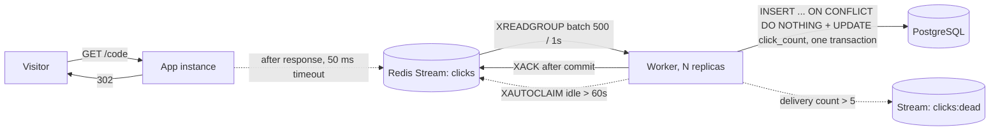

# ADR-004: Asynchronous click analytics via Redis Streams

- **Status:** Accepted (engineer decision, 2026-11-20: Redis Streams instead of an in-process queue, to improve durability)
- **Context:** Recording a click must never slow or fail a redirect (AC-10), should survive app restarts, and must scale independently of the web tier. Analytics may be eventually consistent (seconds).

## Options

| Option | Durability | Latency impact | Complexity |
|---|---|---|---|
| Synchronous DB write in the request | Highest | **Adds a DB round trip to every redirect**; DB outage breaks redirects | Low |
| In-process queue + batch writer | Lost on crash/restart; per-instance | Negligible | Low (rejected by engineer) |
| **Redis Stream + consumer group** | Survives app restarts and worker outages; bounded by Redis persistence | One small `XADD`, sent *after* the response | Medium: extra worker process |
| Kafka / SQS | Strong | Small | Highest: new infra for v1 |

## Decision

**Producer (app).** After the redirect response is sent (Starlette background task), `XADD clicks MAXLEN ~ 1000000 * ...` with fields `url_id, ts_ms, referrer_origin, ua, ua_family, country, visitor_hash`. A client timeout of 50 ms is applied; on any failure the event is **dropped and counted** (`clicks_dropped_total{reason}`), never retried inline, never surfaced to the visitor. `referrer_origin` is computed in the app **before** `XADD`: parse the `Referer` header; keep only `scheme://host[:port]` (lower-cased) when the scheme is http/https; drop userinfo, path, query, and fragment; anything unparseable, over 255 chars, or non-http(s) becomes `null`. The database also enforces this with a CHECK constraint (defence in depth). The raw IP is never put on the stream: the app computes `visitor_hash = HMAC(daily_salt, ip || ua)` first (privacy, A8).

**Consumer (worker, separate process, same image).** Consumer group `click-writers`. Loop: read up to 500 entries (`BLOCK 1000`), insert in **one** transaction using `INSERT ... ON CONFLICT (event_id) DO NOTHING RETURNING url_id`, apply aggregated `click_count` increments only for the rows actually inserted, commit, then `XACK`. Crash before ACK ⇒ redelivery ⇒ the primary key on `event_id` makes it idempotent. Idle pending entries (> 60 s, dead consumer) are taken over with `XAUTOCLAIM`; entries delivered more than 5 times move to `clicks:dead` for inspection (poison messages must not block the stream).

**Guarantees stated honestly**
- Redis → PostgreSQL: at-least-once delivery + idempotent insert = effectively-once storage.
- App → Redis: **at-most-once, best effort.**
- Events can still be lost when: (1) Redis is unreachable or slow at emit time; (2) the app process dies after responding but before `XADD`; (3) Redis crashes within the AOF fsync window (`appendfsync everysec` ⇒ up to ~1 s); (4) the worker is down so long that `MAXLEN ~ 1,000,000` trims unread entries. Each is observable (dropped counter, stream length, pending count, consumer lag) and accepted for v1.

**Redis configuration requirements**
- `appendonly yes`, `appendfsync everysec`.
- `maxmemory-policy volatile-lru`: only keys with a TTL may be evicted. All cache and rate-limit keys carry TTLs; the stream has none, so **the cache can never evict analytics events**. If memory is exhausted and nothing is evictable, `XADD` fails and the app drops events (visible in metrics) rather than corrupting data.
- Production recommendation: separate Redis instances for cache/rate-limit (no persistence, `allkeys-lru`) and for the stream (AOF, `noeviction`). The compose file uses one instance for pragmatism.

## Consequences
- **Implementation notes (Phase 3):** a Redis circuit breaker (3 failures, 5 s) shared with the cache and rate limiter keeps a dead Redis from slowing redirects; drops while it is open are counted as `clicks_dropped_total{reason="circuit_open"}`. Entries whose delivery count exceeds 5 (for example after a PostgreSQL outage lasting five reclaim cycles) move to `clicks:dead`: they are preserved but not counted, and there is no re-drive tool yet.
- New deployable (`worker`) in compose and CI; scales by adding replicas (each consumer name is unique).
- Analytics lag = stream backlog + ≤ 1 s read block; surfaced via `/health/ready` extension later and metrics.
- Tests: integration tests cover emit failure (redirect still 302), redelivery idempotency, and poison-message routing to the dead stream.
- Upgrade path: swap the stream for Kafka behind the same `ClickPublisher` port without touching the redirect logic.
